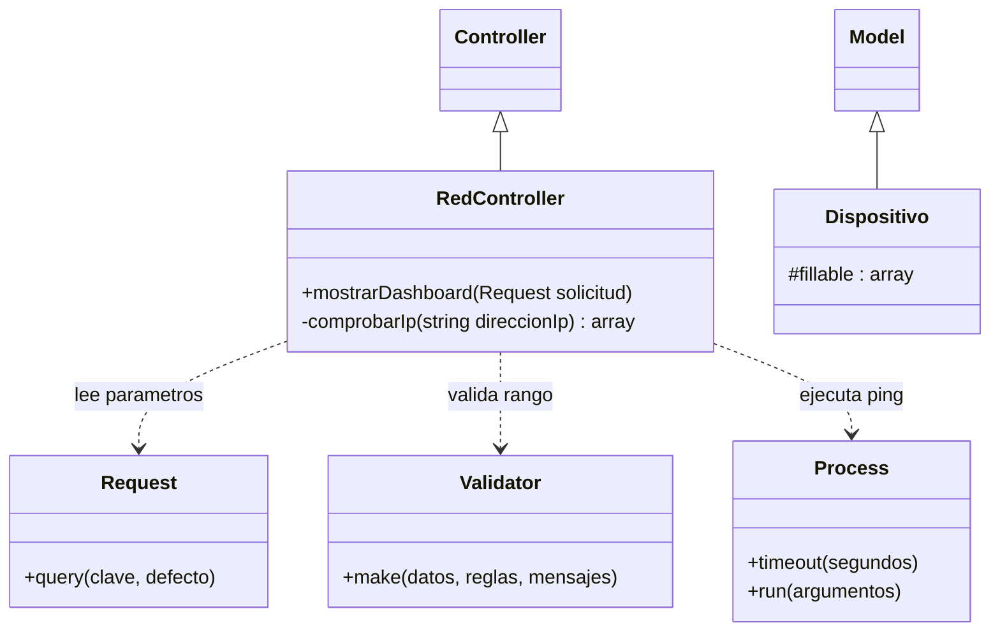
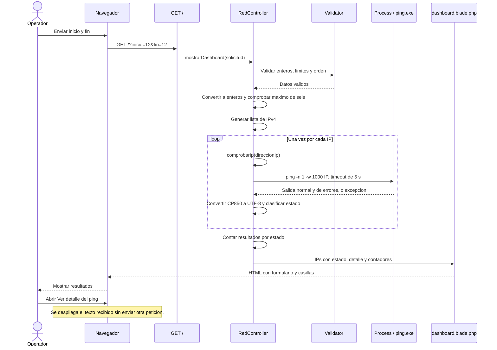
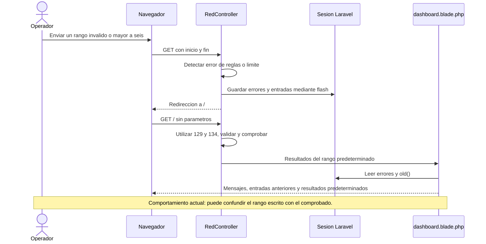
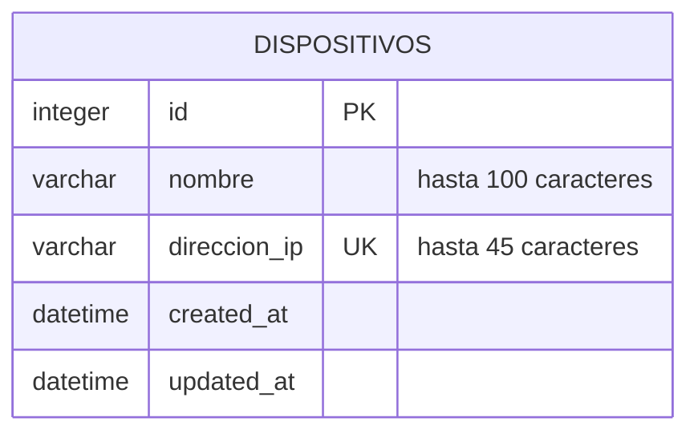

# UML y estructura del sistema

Fecha: 21 de octubre de 2026. Los diagramas describen V2 salvo indicación explícita. Los ejemplos de direcciones pueden cambiar entre redes.

GitHub muestra los bloques Mermaid de clases y secuencia directamente en esta página. Los archivos PlantUML enlazados son fuentes editables: para obtener imágenes se necesita un renderizador compatible; no son imágenes ya exportadas.

## 1. Diagrama de clases — implementación actual

`Controller`, `Model`, `Request`, `Validator` y `Process` son clases de Laravel. El diagrama representa las dependencias que utiliza el código, no todos los métodos del framework.

No se dibuja una dependencia de `RedController` hacia `Dispositivo`: todavía no existe. Los campos de la tabla se representan en el esquema de datos, porque son atributos persistidos de Eloquent, no propiedades PHP declaradas individualmente.

## 2. Diagrama de secuencia — rango válido

La captura de excepciones ocurre en `comprobarIp()`. Para abreviar, el recorrido muestra una respuesta general del proceso; los errores se convierten en un resultado con estado «Error al comprobar».

## 3. Diagrama de secuencia — validación fallida

## 4. Casos de uso

Fuente UML: [casos-uso.puml](uml/casos-uso.puml).

| Caso | Actor | Estado |
|---|---|---|
| CU-01 Comprobar rango | Operador local | Implementado; incluye validación y ejecución de pings |
| CU-02 Consultar resumen | Operador local | Implementado |
| CU-03 Consultar detalle de ping | Operador local | Implementado |
| CU-04 Registrar dispositivo | Operador local | Futuro; modelo y tabla preparados |
| CU-05 Consultar y comprobar dispositivo guardado | Operador local | Futuro |

El supervisor revisa código y documentación en GitHub. No se representa como un rol con permisos dentro del dashboard porque ese control de usuarios no está implementado.

## 5. Actividad y despliegue

- [Actividad de comprobación](uml/actividad-comprobacion.puml): validación, límite, recorrido, clasificación y respuesta.
- [Despliegue local](uml/despliegue-local.puml): navegador, Laravel, ping de Windows y archivo SQLite. Distingue las consultas ICMP del almacenamiento preparado.

## 6. Estructura de datos — esquema ER, no UML

Se muestra solo la entidad propia del proyecto. Laravel también incluye tablas auxiliares de usuarios, sesiones, caché y trabajos mediante sus migraciones iniciales. Actualmente las comprobaciones no se guardan en `dispositivos` ni en otra tabla propia.

## 7. Diseño futuro, separado de la implementación

El futuro registro necesitará una ruta POST, validación del nombre y de la IP, y una acción que utilice `Dispositivo` para persistir datos. También se necesitará una consulta para el listado y una acción de comprobación individual. No se asignan nombres de métodos como si ya existieran; se decidirán durante la siguiente etapa de implementación.
